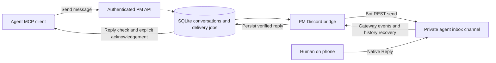

# Discord agent conversations

Status: Implemented in the working branch, 2026-11-12; live private-channel acceptance awaits bot configuration. Scope: a two-way Discord channel between a human and the originating agent conversation, exposed through the PM client MCP. See [setup and operation](../discord-agent-setup.md) for deployment, testing and the explicit agent polling/resume contract.

## Product decision

Add `pm_send_discord_message` and a durable reply inbox to PM. Run a Discord bot in a dedicated private `#agent-inbox` text channel. An agent sends a short description of what it is working on and its message; the human uses Discord's native **Reply** action; PM delivers that reply to the originating conversation. Neither direction requires a PM link or an open PM browser.

The primary message structure is deliberately small:

1. **Work header:** project, what the agent is working on, and a short conversation identifier.
2. **Message:** what happened, what the agent needs, or the important result.
3. **Reply expectation:** whether an answer is needed. PM supplies the delivery footer.

Example rendered Discord message:

```text
@Alex  QUESTION · rynx · Audio routing · K7Q2

The microphone and game audio now share the selected output.
Should I also send the piano to Discord, or keep it local?
I can finish the device selector while waiting for your answer.

Reply to this message to answer this agent conversation.
PM message 8F3N7Q2R
```

`@Alex` above represents a real, configured Discord user mention. The project name and authenticated sender identity come from PM; the work title and message come from the agent. The short identifiers disambiguate similar sessions without exposing worker keys or filesystem paths. No task association is required.

**Use a bot for the two-way version.** Incoming webhooks post to Discord channels; receiving Discord message events requires an additional integration. A single bot can send and receive, so adding a webhook alongside it would add an unnecessary credential. Keep the existing integrator webhook and channel separate. A second webhook in the same integrator channel would not solve the visibility problem. [Discord webhooks](https://docs.discord.com/developers/resources/webhook), [Discord Gateway](https://docs.discord.com/developers/events/gateway).

## Existing PM foundations

| Existing surface | Consequence for this feature |
| --- | --- |
| `packages/server/src/events/alerts-listener.ts`, `postDiscord` | Reads `settings.webhooks.discord_url`; shares a master mute with the train feed; posts without a durable queue, retry, timeout, or HTTP-status check. Keep this feature independent of that delivery contract. |
| `packages/server/src/events/train-feed-listener.ts` | Existing train narration continues to its existing destination. Direct conversations never enter this feed. |
| `packages/web/src/pages/settings/notifications-page.tsx` | Natural place for an additional **Agent conversations** card. Existing settings are read and replaced as a JSON blob; use dedicated endpoints for the new configuration. |
| `packages/server/src/routes/projects.ts` | Project settings appear in generic project responses and have no human-admin gate in this route. Do not put the bot token or authoritative conversation routing in this blob. |
| `packages/mcp-server/src/piggyback.ts` | Already appends unread escalation notices to tool responses. Extend the pattern with a separate conversation inbox and session-scoped lookup. |
| `packages/mcp-server/src/tools/check-messages.ts` | Existing escalation drain remains compatible. Its worker-key-only addressing and automatic cursor advancement are not the new conversation delivery contract. |
| `packages/wake-daemon-ref/src/loop.ts` | Starts a fresh worker turn for escalation replies. This is not an exact-session resume mechanism and must not consume Discord replies automatically. |
| `packages/server/src/index.ts` | Owns background-service lifecycle outside `createApp()`. Start and stop the Discord bridge here, following the alert-sweep lifecycle pattern. |

This feature reuses PM authentication, SQLite/Drizzle, shared schemas, API envelopes, audit infrastructure, and MCP transport. It does not create fake escalations, notes, or tasks merely to transport a conversation.

## Human experience

### Sending and replying

The agent calls the send tool when it needs a decision, encounters a blocker, or has an important result. Routine progress belongs in the existing work surfaces. `kind` is `question`, `blocked`, or `update`; it changes the label and reply guidance, not the ability to bypass limits. Questions and blockers default to requesting a reply. Updates do not.

The human replies to any mapped message in that conversation: an agent message, a previous accepted human reply, or its bot receipt. PM resolves the referenced Discord message ID to the conversation. It never guesses from the most recent agent, the channel, the title, or quoted text. Follow-up agent messages use the same header and reference the conversation's root message when it still exists.

On receiving an authorized reply, the bot posts a small, unmentioned receipt:

```text
Saved for “Audio routing · K7Q2”. Waiting for the agent to check in.
```

After the agent explicitly acknowledges the reply through MCP, edit that receipt:

```text
Received by the agent. This does not yet mean the requested work is done.
```

The receipt is sent only after the reply commits to SQLite. Receipt creation and edits are durable delivery jobs; a receipt failure never discards the human's reply. Receipts do not ping the human, and the bot ignores its own messages as human input.

Plain channel messages are not broadcast to agents. For an authorized human, respond with a rate-limited hint to use **Reply**. Messages from other users are ignored. Text-only replies ship first. For attachment-only, voice, sticker, or unsupported messages, explain that a text reply is needed; do not acknowledge empty input as delivered. When a message contains both text and attachments, preserve the text and explicitly state that attachments were not forwarded. Do not fetch attachment URLs.

Edits and deletions in Discord are not a remote undo mechanism. V1 captures the text accepted at ingestion and instructs the human to send a new reply for corrections. A deletion before PM has ingested or recovered a message may make that reply unrecoverable. Avoid claiming Discord is the permanent system of record; SQLite holds the accepted conversation.

### Delivery truth

| Visible state | Meaning |
| --- | --- |
| Queued | PM saved the outbound message. Discord has not confirmed it. |
| Sent to Discord | Discord returned a message receipt or PM reconciled the exact bot message. It does not prove a phone notification or a human read. |
| Reply saved | PM durably stored the human reply. |
| Received by agent | The owning agent explicitly acknowledged the reply ID. It does not mean the instruction was executed. |
| Waiting for agent | A saved reply has not been acknowledged. Do not infer that a running MCP process means the model is reading. |
| Delivery uncertain / failed | Show the distinction and the next recovery action. Never turn a timeout into a success claim. |

Mention the configured recipient in the message content and restrict allowed mentions to that recipient. User notification settings can still affect phone delivery; setup must include a real phone test. [Discord allowed mentions](https://docs.discord.com/developers/resources/message#allowed-mentions-object).

## Conversation identity and agent lifecycle

An authenticated PM user identifies the sender. A worker slot identifies reusable infrastructure. A conversation identifies the discussion. These are separate concepts.

- Each conversation has a server-generated ID, project ID, owning PM user ID, origin session ID, display title, short public code, and route version.
- The MCP transport supplies `PM_SESSION_ID`, a new optional launcher-provided identifier stable for one agent conversation across MCP reconnects. It is distinct from `PM_WORKER_KEY`, which must retain its existing stable-slot semantics.
- If the launcher provides no session ID, the MCP process generates one UUID for its lifetime. The send result explicitly reports that reconnect recovery will require resuming the returned conversation ID. Never generate or rotate worker keys for this feature.
- The MCP client sends session identity as transport metadata, not a model-selected author field. The API checks the authenticated owner before using a session ID for routing; knowing a session ID or conversation ID is not authorization.
- A new process can explicitly resume an existing conversation under the same authenticated owner by passing its conversation ID. Rebinding its origin session is an atomic, audited operation that invalidates the previous consumer generation. A different PM user requires a human-admin reassignment with a reason. Repeating resume into the already-bound session is idempotent.
- Two sessions sharing one stable worker slot must not automatically drain each other's conversations. Session-wide inbox discovery is restricted to that session; explicit conversation operations also require the current binding generation.

The normal live path is the existing MCP response piggyback plus an explicit reply check. While awaiting a decision, the agent calls the reply tool with a bounded wait, checks between work steps, and continues waiting or working according to the task. Long-running shell tools cannot be interrupted by this feature.

An ended CLI session cannot be revived by a generic MCP tool. Its replies remain pending and are retrieved on explicit resume. V1 does not promise automatic continuation of arbitrary clients. If unattended restart is later required, add a launcher adapter with a saved host session locator, repository/cwd, a single-consumer lease, and an explicitly configured resume command. That adapter must resume the intended session or report that it cannot; it must not guess from `PM_WORKER_KEY` or launch unrelated fresh work. The existing wake daemon can supply budgeting and retry patterns, but is not wired to this inbox in v1.

Closing a conversation prevents new agent sends. A human reply to a closed conversation gets a clear closed notice and is retained as pending review for its owner; it never routes to a newly assigned worker. Closure and transport availability are separate from whether any reply has been acknowledged.

## MCP contract

Tool arguments use the repository's snake_case convention; REST uses camelCase. All result objects have shared schemas and a concise text rendering. Discord user IDs, bot credentials, guild/channel overrides, sender identity overrides, and arbitrary URLs are absent from the model-facing send tool.

### Primary tool

```ts
pm_send_discord_message({
  project_id: string,
  session_title: string,            // 1..100 characters; what you are working on
  message: string,                  // 1..1500 characters; standalone text
  idempotency_key: string,          // stable per logical send; 1..128 characters
  kind?: "question" | "blocked" | "update", // default update
  conversation_id?: string,        // omit to start; reuse to continue
})
```

The server bounds the final rendered content to 2,000 characters, including the mention, escaped header, reference, and instructions. Reject oversize input with the actual supported limit; never silently truncate or split one notification into several pings. Cap server-supplied display labels separately. Preserve the exact accepted body in PM.

The first call atomically creates a conversation and its first outbound message. Reusing a conversation requires matching project, ownership, active session binding, and route version. Its title remains stable; a conflicting title returns a useful error rather than silently renaming past messages.

Example result:

```json
{
  "conversation_id": "<conversation-id>",
  "conversation_code": "K7Q2",
  "message_id": "<message-id>",
  "delivery_status": "queued",
  "duplicate": false,
  "reply_requested": true,
  "reconnect_mode": "launcher_session_id",
  "next_action": "Check pm_check_discord_replies while awaiting the answer."
}
```

Accepted means persisted. The tool returns promptly and does not block on Discord. Retry the same logical send with the same idempotency key. Uniqueness is `(project_id, authenticated_owner_id, idempotency_key)`, including initial conversation creation. Identical retries return the original record even after a reconnect or configuration change; different payloads using the same key return `IDEMPOTENCY_CONFLICT`. Compare the immutable logical request, excluding transport session metadata. Idempotent lookup occurs before current routing and quota admission, after authorization.

Tool guidance: include the decision or result in the body, provide the minimum useful context, and say what work is waiting. Do not send secrets, transcripts, build logs, repeated reminders, or routine per-step progress. A Discord answer is a human message subject to the agent's normal instruction and approval boundaries, not a privileged system instruction.

### Reply and lifecycle tools

| Tool | Contract |
| --- | --- |
| `pm_check_discord_replies({ conversation_id?, wait_seconds?: 0..25, limit?: 1..50 })` | Returns unacknowledged replies for the current session, or the explicitly specified bound conversation. Default wait 0, limit 20. Includes immutable reply ID, conversation/title, verified human attribution, body, received timestamp, and pagination. Reading never acknowledges. |
| `pm_ack_discord_replies({ conversation_id, reply_ids })` | Explicitly acknowledges up to 50 previously returned reply IDs. Owner and binding generation checked; idempotent; no high-water mark that could skip an unseen reply. Drives the receipt edit. |
| `pm_get_discord_conversation({ conversation_id, before_seq?, limit? })` | Reads history, outbound status, failure details, and pending reply count. Bounded pagination, default 50, maximum 100. |
| `pm_resume_discord_conversation({ conversation_id })` | Explicit same-owner transfer to the current session, with generation fencing and audit. Returns full context plus unread replies. Never implicitly transfers a live binding during send or check. |
| `pm_close_discord_conversation({ conversation_id })` | Marks the conversation closed; retains history and pending replies. Idempotent. |

Piggyback only announces unread count and conversation titles and points to `pm_check_discord_replies`; it never consumes replies. Cache by authenticated owner and session, with the existing 10-second pattern. The reply check itself bypasses that cache. An inbox lookup failure must not fail or alter the main tool result. Keep `pm_check_messages` escalation behavior compatible.

Reply responses include the consumer generation; the MCP adapter attaches that same generation to acknowledgements. It must not refresh the generation behind the model's back after a rebind. Extend `pm_get_my_work` with an additive list of the caller's open conversations and pending reply counts so a restarted client can discover IDs to resume without knowing the old process's generated session ID. That discovery does not return reply bodies or consume another session's inbox.

## Server and Discord architecture



Use one background Discord bridge in the PM server process. It owns the bot connection, outbound dispatch, inbound ingestion, history reconciliation, and receipt updates. PM remains usable if Discord is unavailable. All workers talk to PM; no agent MCP process holds the bot token or opens a Gateway connection. No new public callback endpoint or inbound LAN port is required: the bridge initiates the Discord connections. [Gateway connection model](https://docs.discord.com/developers/events/gateway).

Use a maintained Discord SDK for Gateway heartbeat, reconnect/resume, and REST rate limiting. Pin a release compatible with the supported Node runtime and test the packaged server. Do not install an unpinned current SDK and accidentally change PM's Node requirement: the current discord.js main documentation requires a newer Node major than PM's declared Node 22 minimum. Either choose a supported compatible release or make the runtime upgrade an explicit implementation prerequisite. [discord.js installation requirements](https://discord.js.org/docs/packages/discord.js/main).

Start services from `server/src/index.ts`, not `createApp()`. Expose injectable transport, clock, and storage seams for tests. A SQLite singleton bridge lease prevents two PM processes using the same database from independently owning the bot connection. Shutdown stops new claims, disconnects the Gateway, waits a bounded period for HTTP work, and leaves unfinished jobs recoverable.

### Discord configuration

- One application bot, invited to the intended server. Grant only **View Channel**, **Send Messages**, and **Read Message History** on the dedicated ordinary text channel. No Administrator permission, webhook management, role management, or arbitrary command execution.
- Enable `GUILDS`, `GUILD_MESSAGES`, and `MESSAGE_CONTENT` intents for native text replies. Enable the privileged content intent in the Developer Portal and obtain approval if Discord requires it for the application. Do not rely on whether a human left the reply's bot mention enabled. [Gateway intents](https://docs.discord.com/developers/events/gateway#message-content-intent).
- Server-only `PM_DISCORD_BOT_TOKEN` and `PM_DISCORD_AGENT_MESSAGING_ENABLED=false` by default. The global switch overrides route enablement. Missing token or disabled master means no Discord connection.
- A human admin configures each project's guild ID, channel ID, and recipient mapping `(pm_human_user_id, discord_user_id)`. V1 has one recipient per project; several projects may intentionally share the same private inbox channel.
- Configuration lives in dedicated route rows, not `projects.settings`. The bot token lives in the deployment secret environment and is never returned in API responses or stored in message payloads. Display only token-present status and bot identity.
- Validate channel/guild consistency and required permissions through Discord. Reject forum/thread/voice destinations for v1. Warn if the destination is the known integrator channel; guide setup toward a separate channel.

The configured PM recipient must be an active human. Inbound authorization checks the exact Discord user ID, guild ID, channel ID, current enabled route, and message reference. Display names are not authentication. No inbox scraping, DMs, other channels, mentions from strangers, webhook-authored messages, or bot-authored messages are accepted as human instructions.

## Durable state

Names below are proposed table names. Use shared enum/schema definitions, foreign keys where meaningful, and the existing ULID/time conventions.

| Table | Essential contents and invariants |
| --- | --- |
| `discord_agent_routes` | Project PK, enabled flag, guild/channel IDs, PM human and Discord recipient IDs, generation, activation timestamp, verification/test timestamps, optional test-until deadline, created/updated by. Human-admin writes only. No token. |
| `agent_conversations` | ID, unique short code, project/route generation, immutable destination and recipient snapshot, owner PM user, optional server-resolved worker slot for audit, origin session ID, consumer generation, stable title, open/closed status, test flag, last client check, timestamps. Title is not routing identity. |
| `agent_conversation_messages` | ID, conversation ID, per-conversation sequence, direction `agent\|human\|system`, immutable accepted body, sender attribution, reply-to relation, creation/Discord timestamps, primary Discord message ID when known, reply acknowledgement timestamp and binding generation. Unique `(conversation_id, seq)`. Human messages remain available after acknowledgement. |
| `discord_delivery_jobs` | ID, associated message or receipt target, operation `send\|receipt_create\|receipt_edit`, immutable render snapshot, logical request hash/key, route generation, unique public message reference, unique nonce up to 25 characters, delivery status, attempts, next-attempt/expiry times, lease/fence, Discord receipt, sanitized last error, uncertainty flag. A unique logical operation key prevents duplicate receipt jobs. |
| `discord_message_links` | Unique `(channel_id, discord_message_id)` maps to one canonical conversation message and optional delivery job. Several provider IDs may map to one logical message after an ambiguous retry. Use this table for all reply-reference resolution, including receipts. |
| `discord_inbound_events` | Unique provider message ID, validated channel/author, reference ID, text snapshot, provider timestamp, resolution status, failure category, and canonical message ID after acceptance. Durable staging for out-of-order references and interrupted history scans. Never stage unauthorized authors or unrelated channel history. |
| `discord_channel_state` | One row per bot/channel, shared across projects: reconciliation watermark, in-progress scan bounds/cursor, last successful history sync, last transport activity, health. A dedicated singleton service-state row holds the bridge lease and fencing token. |

Record attempt results and route/resume/reassignment actions through the existing append-only audit mechanism, extending its enums deliberately. Audit metadata includes IDs, status codes, attempt numbers, and timings, not bot tokens or full message bodies. Receipt operations are system messages and never appear in the agent's human-reply inbox.

Index jobs by `(status, next_attempt_at)`, conversations by `(owner_user_id, origin_session_id, status)`, unacknowledged human messages by conversation/sequence, and provider messages by `(channel_id, discord_message_id)`. Idempotency uniqueness is enforced by the database inside the same transaction as conversation/message/job creation, not an in-memory check.

Retain conversation history and idempotency records in v1; no automatic destructive retention job. Expose row/storage counts so retention can be added deliberately if needed. Existing database backups include conversations and require the same protection as other PM content. Archive a project without deleting these rows. Explicit project deletion must stop delivery and handle the new rows transactionally through the project's established deletion policy; stale jobs may never send after deletion.

## Outbound delivery

Persist the message and job before returning `202`. Wake the dispatcher immediately; use a one-second due-job sweep as crash recovery. Under a healthy transport, target dispatch within two seconds. This is a local service target, not a guarantee of phone delivery.

```text
queued -> sending -> delivered
                  -> retry_wait -> sending
                  -> failed
queued / retry_wait -> expired or cancelled
```

Claim a job atomically with a short lease and monotonically increasing fencing token. Do not hold a SQLite transaction over a network call. Use a ten-second network timeout and a lease longer than that timeout. Only the current claimant can commit its result. On expired leases, reconcile ambiguous sends before retrying; fence stale claimants. Serialize sends per channel and preserve conversation order while allowing unrelated channels to progress.

Send with a stable persisted `nonce` and `enforce_nonce=true`. Discord's duplicate suppression has a limited recent window, so PM idempotency and reconciliation remain necessary. The returned message ID is the delivery receipt. [Discord Create Message](https://docs.discord.com/developers/resources/message#create-message).

| Outcome | Required action |
| --- | --- |
| Success with valid receipt | Persist Discord IDs and mark delivered. Match any pending reply or receipt work. |
| HTTP 429 | Respect provider retry timing, bucket limits, and any global cooldown. Retain the job; do not busy-loop or count this as an ordinary failure attempt. |
| Network timeout, reset, uncertain 5xx, crash after send | Mark uncertainty; reconcile exact bot messages by nonce/reference before resending. Reuse the same nonce. |
| Retryable provider/server failure | Exponential backoff with jitter, starting at 2 seconds, capped at 60 seconds; at most 8 non-429 attempts and a one-hour expiry from initial acceptance. |
| Permanent 400 | Fail with a sanitized validation category. Do not retry identical malformed content. |
| 401 or 403 | Mark affected bridge/route unhealthy, stop repeated sends, expose token/permission repair guidance. |
| Deleted channel or missing destination | Fail visibly; do not fall back to the train channel. |
| Expiry | Stop retries and show expired, retaining any uncertainty flag. Require an explicit human retry operation for a fresh delivery job. |

Provider rate limits are discovered from headers and errors rather than encoded as guessed Discord quotas. [Discord rate limits](https://docs.discord.com/developers/topics/rate-limits).

If history recovery cannot resolve an uncertain send, bounded retries may still produce a duplicate after Discord's nonce window. Preserve the same visible message reference so the duplicate can be recognized and mapped to the same conversation. State the guarantee as **durable acceptance with bounded retry and deduplication**, not exactly-once end-to-end delivery. Store all reconciled provider IDs for a logical message if duplicates occurred; replies to either must route correctly.

Use `allowed_mentions` with an empty `parse` list and only the configured recipient in `users`. Agent-supplied mentions cannot ping other users or roles. Disable replied-user pings on follow-ups and receipts. Ensure edits also specify the mention policy. The transport base URL is fixed to Discord's API, with no caller-supplied destination URL.

Product-level noise limits are separate from Discord's limits: propose five new agent messages per conversation per ten minutes and thirty per project per hour, enforced transactionally from durable admissions. Count distinct accepted sends, not idempotent replays or retries. Cap pending outbound agent messages at 100 per project. Return `429` with `retry_after_seconds`; do not silently suppress. These initial defaults are tunable by operators, and never bypassed by `kind=blocked`. Human reply capture remains available even when outbound agent quotas are exhausted; reserve bounded transport capacity for receipts.

## Inbound delivery and recovery

The Gateway supplies low-latency events; the database and channel-history reconciliation supply recovery. A Gateway connection being healthy is not evidence that every reply was saved.

1. Validate channel/guild/author and resolve `message_reference.message_id` to a stored conversation message or receipt. Ignore unauthorized input before persistence. Replies to accepted human messages inherit the same conversation.
2. If a referenced bot message arrived before its HTTP receipt was committed, reconcile it using the bot author ID, exact configured channel, and a persisted nonce or unique PM message reference. Never trust a matching footer on a human or webhook message. Verify the expected render before attaching an unknown provider ID.
3. Insert the human reply, provider-message link, and receipt job, and mark its staged inbound event accepted, in one transaction. A unique Discord message ID makes repeated Gateway events and history scans idempotent. Order accepted replies by per-conversation sequence, preserving provider timestamps for context.
4. Notify waiting MCP requests and invalidate the owning session's unread cache after commit. An event-bus failure cannot undo or hide the saved reply; the next read still returns it.
5. The agent reads, processes the message as human input, and explicitly acknowledges the specific reply IDs. Ack failure leaves replies unread; the agent deduplicates repeated IDs. A read response lost in transit cannot consume a reply.

On startup, reconnect, and periodically (initially every 60 seconds), scan channel history since the durable reconciliation watermark. Capture a fixed upper message ID and page backward toward the previous watermark, then process the fetched range oldest-first. Persist scan progress and unresolved references. Do not advance the committed watermark past a failed or unresolved eligible message. Live Gateway events must not advance this history watermark, or an early newer event could hide older missed replies.

History reads support pagination; never treat one page as a complete outage recovery. Catch-up uses a bounded amount of work per tick and reports remaining lag without skipping the remainder. Stage eligible unresolved references in `discord_inbound_events` and retry after outbound mappings or earlier messages become available. Fetch a missing reference from the configured channel to distinguish an unmanaged message from a pending PM send. A definitively unmanaged reference is rejected with a routing hint. Unresolved transport failures remain pending and visibly degraded; they do not become successful delivery. [Discord channel history](https://docs.discord.com/developers/resources/message#get-channel-messages).

On first enable, initialize the channel watermark at enable time, before the test message, so old unrelated history is not imported. Enabling another project on an already watched channel does not reset its cursor. Recovery filters by each route's activation/generation, and a restarted bridge must never reset the cursor to “now.” A missing history permission or failed catch-up remains visibly degraded.

Receipt delivery is independently recoverable. Both receipt sends and edits use persistent operation keys, are unmentioned, and reconcile before replay. An authorized but unmapped plain message gets at most one hint per user per minute; bot responses cannot recursively trigger more responses.

## REST, authorization, and settings UI

All endpoints are authenticated under `/api/v1`. Do not place these under `/webhooks/*`, which the current auth middleware exempts.

| Endpoint | Access and result |
| --- | --- |
| `GET /projects/:id/discord-agent-route` | Human admin gets redacted configuration and bridge/channel health. Ordinary agents get only capability availability through their send/check responses. |
| `PUT /projects/:id/discord-agent-route` | Active human admin only; validates IDs, mapping, channel permissions, and optimistic config generation. No bot token in request or response. |
| `POST /projects/:id/discord-agent-route/test` | Human admin explicitly requests one labelled test conversation, sent through the real durable path. Tests reply capture and an explicit acknowledgement round trip; results distinguish API success from a human-confirmed phone notification. |
| `POST /projects/:id/agent-conversations/messages` | Active authenticated caller; configured project route required; creates or continues an owned conversation. Body includes the logical idempotency key. Returns `202`, or `200` for an identical replay. |
| `GET /projects/:id/agent-conversations` | Cursor-paginated list for the owner or mapped human/admin; summaries and unread counts, filtered to the caller's authorized conversations. Supports settings history and recovery discovery. |
| `GET /agent-conversations/:id` | Owner or mapped human/admin; bounded history and delivery state. |
| `GET /agent-conversations/replies` | Owner plus current origin session binding; optional conversation and bounded wait. Read only. |
| `POST /agent-conversations/:id/ack` | Owner/current consumer generation; explicit reply IDs; idempotent. |
| `POST /agent-conversations/:id/resume` | Same authenticated owner; explicit audited session rebinding. |
| `POST /agent-conversations/:id/close` | Owner/current binding or mapped human/admin. |
| `POST /agent-conversations/:id/reassign` | Human admin, reason required; rotates consumer generation and records before/after owners. |
| `POST /agent-conversations/:id/messages/:messageId/retry` | Human admin, reason and idempotency key required; creates a linked new job after checking uncertainty and current route. Does not erase original failure evidence. |

New sends use PM's existing trusted-team project visibility; this feature does not invent project membership checks that the current schema lacks. Conversation reading/consumption is narrower: owner and mapped human/admin. Status APIs must not expose other sessions' reply bodies. New SSE events carry IDs/status only and are filtered by these same readers; do not leak message bodies through the existing global event stream or activity-log changes.

New error codes include `DISCORD_NOT_CONFIGURED`, `DISCORD_DISABLED`, `DISCORD_ROUTE_UNHEALTHY`, `CONVERSATION_CLOSED`, `SESSION_MISMATCH`, `IDEMPOTENCY_CONFLICT`, `MESSAGE_TOO_LONG`, `RATE_LIMITED`, and `QUEUE_FULL`, alongside existing auth/not-found errors. A disconnected Gateway alone permits outbound enqueue when configuration is valid, but reports reply reception as degraded. A known invalid token or missing send permission rejects new sends with repair guidance. Once accepted, the original record remains queryable regardless of later configuration changes.

Extend the Notifications settings page with an independent **Agent conversations** card:

- Bot identity and connected/disconnected/recovering status; token-present indicator.
- Guild/channel IDs and resolved channel name; human recipient mapping; enable toggle.
- **Send test**, then “reply to the test message in Discord”; show capture and acknowledgement steps separately.
- Pending sends, oldest pending age, unread replies, last successful send, last inbound reply, last history sync, and recent sanitized failures.
- Recent conversation history with status and manual retry/reassignment controls for human admins.

The integrator card retains its current controls and configuration. The agent card uses its own API and generation check; saving either card cannot clobber the other.

The global bridge must be running for a test. An explicit admin test grants a ten-minute exception to the project's disabled state for that labelled test conversation only; normal sends remain disabled. Ingestion accepts only replies mapped to that test and its configured human during the exception. An expired test grant cannot enable general delivery. Mark test acknowledgements as test results rather than claiming a real agent read them. Enabling the project after a successful test does not transfer the test conversation into normal work.

Changing destination, recipient, or enabled state increments route generation. Cancel old unsent jobs and suspend old conversations; require explicit human migration or closure rather than silently moving their messages to a different audience. In-flight HTTP calls may still finish, so label that boundary honestly and record their receipts without retrying. Never post an old conversation's pending replies into a newly configured destination. A disabled route stops ingestion as well as sends; setup explains that replies posted during a deliberate disable are not delivered automatically when re-enabled.

For v1, migration means an admin explicitly opens a successor conversation on the new route with a reviewed summary and a reference to the predecessor; pending messages are not bulk forwarded. Keep the old recipient's identity on the predecessor for history authorization. Current project configuration must not automatically grant a replacement recipient access to old private conversations.

## Implementation sequence and verification

| Slice | Work | Exit criteria |
| --- | --- | --- |
| 1. Contract and persistence | Shared schemas, route/conversation/message/job/channel state tables, indexes, audit enums, owner/session authorization, migration. | Transaction rollback, duplicate initial sends, conflicting keys, cross-owner access, concurrent session consumption, generation changes, and migration checks pass. Generate a fresh migration with a real monotonic non-future journal timestamp. |
| 2. Discord bridge | SDK/runtime decision, lifecycle, permissions validation, outbox dispatcher, receipt jobs, Gateway ingress, history recovery. | Restart-after-enqueue, crash-after-provider-send, 429/global limit, 5xx, invalid token, removed channel, multi-page catch-up, duplicate/out-of-order events, unknown references, and concurrent dispatcher tests pass with a fake transport. |
| 3. MCP integration | Register primary and companion tools, session metadata, API client methods, structured/text results, unread piggyback. | Session A cannot drain B; reconnect/resume preserves replies; lost read responses do not consume; ack is explicit; old escalation tools retain behavior; no Discord token reaches MCP. |
| 4. Web configuration and operations | Notifications card, test flow, health/history UI, failure and retry controls, redacted APIs and SSE. | Human-admin gates enforced server-side; config updates cannot clobber train settings; disabled/partial configuration states are usable; no credential/body leaks in logs or events. |
| 5. End-to-end and rollout | Worker guidance, MCP README, deployment/setup docs, environment template, packaged-server checks, private-channel live acceptance. | A phone reply reaches the correct live agent; restart recovery and stopped-session pending/resume behavior are demonstrated; train narration remains in its original channel. |

Expected code touchpoints: new shared `agent-conversation` schemas and exports; `server/src/db/schema.ts` and a generated migration; new server route/service/Discord transport modules; `server/src/app.ts` and `index.ts`; audit and filtered SSE integration; `mcp-server/src/tools/discord.ts`, tool registration, API client, session metadata, and piggyback; the Notifications page, hooks, generated API types, and relevant tests. Extend project deletion handling and production dependency packaging as needed.

Regenerate OpenAPI/web types after server contracts stabilize. Run focused server/shared/MCP/web tests, then `pnpm typecheck`, `pnpm lint`, `pnpm build`, and the required repository test suite before merge-train submission. Include an API-level end-to-end conversation test plus a browser test of the configuration/test flow. Unit/integration tests must never send real Discord messages.

Live acceptance, using an explicitly configured private test channel:

1. Send from two sessions with similar titles; confirm distinguishable headers and the intended phone mention.
2. Reply to the older session's message; only that conversation sees it. Read without ack, reconnect, read again, then ack; Discord's receipt changes only at the final step.
3. Keep an agent waiting in the bounded reply tool; answer from the phone and verify the reply arrives without opening PM. Have the agent send its next response into the same conversation.
4. Restart PM while a human reply arrives. Verify multi-page history recovery if needed and no skipped or multiply accepted reply.
5. Stop the originating agent, reply, and verify “waiting for agent”; explicitly resume and receive the pending answer. Never claim the old process was automatically resumed.
6. Exercise an unauthorized user, a wrong-channel reply, a closed conversation, a removed permission, a destination change, and a repeated idempotency key. Confirm no cross-conversation delivery and no fallback into the train feed.

The release is opt-in: deploy schema/code with the bridge disabled, configure the bot and private channel, complete the real send/reply/ack test, then enable selected projects and reconnect client MCPs to expose the tools. Roll back behavior by disabling the bridge; retain history and pending records. This design does not create a Discord application, install a bot, send a message, or alter live PM settings.
